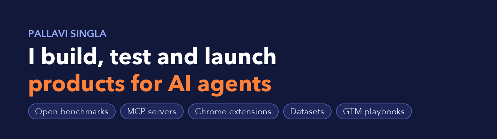
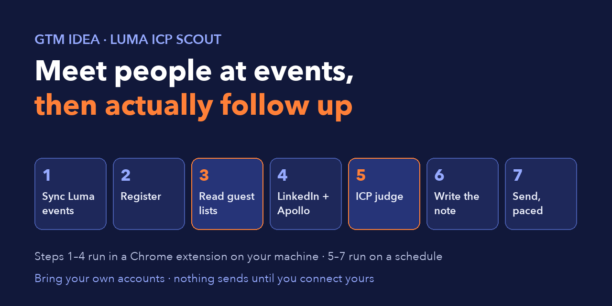
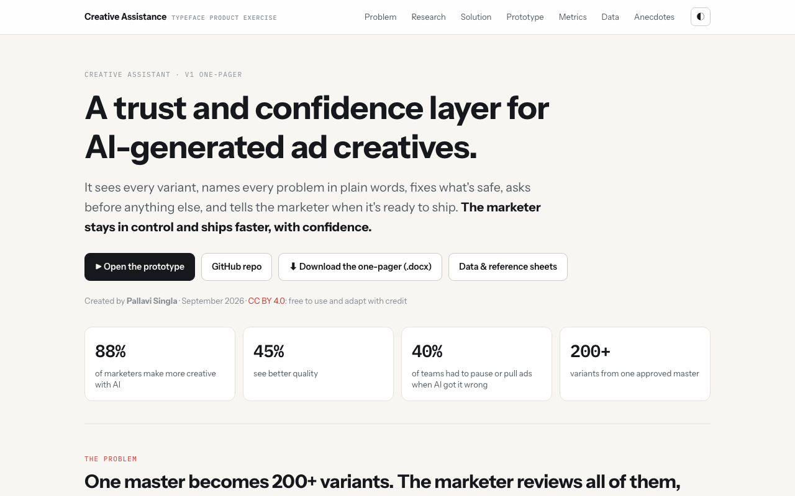

## 👋 About me

I'm Pallavi. I work where AI products meet the people who adopt them. I test the tools agents depend on, turn what I learn into something developers can use the same day, and take it to market.

| 🔬 **Evaluate** | 🛠️ **Build** | 🚀 **Launch** |
|---|---|---|
| Live benchmarks with real answer keys, graded with published rubrics | MCP servers, Chrome extensions, datasets and prototypes | GTM memos, target-account maps, positioning and distribution |

## ✨ Building now: Magic

**Magic is the personal context layer: a private AI that shows people who they're becoming and how to grow.**

We live in dozens of apps, multitask all day, and now AI does whole tasks for us, so few of us can say where our time went, what we learned, or what to do next. Magic privately records what you do on your laptop and on-device AI turns it into a living picture of you: skills from first read to applied, personality from behaviour, blind spots, and one next step per area. Nothing leaves your laptop.

| 20,429 | 988 | 27 | 0 bytes | 26 days |
|:---:|:---:|:---:|:---:|:---:|
| moments recorded | ideas mapped | topics | sent to the cloud | first commit to live |

The core app (Rust recorder, on-device AI pipeline, knowledge graph) is in a private repo. Access on request: <a href="mailto:pallavi.singla@berkeley.edu">pallavi.singla@berkeley.edu</a>.

---

## 🗂️ Projects at a glance

<table>
<tr>
<td width="33%" valign="top">

<h3>🔎 Web Search API Eval</h3>
Which web search API should power your AI agent? An open benchmark of You.com, Tavily, Exa and Parallel, usable from Claude, ChatGPT, npm and Hugging Face.  
<a href="https://psinglap.github.io/websearch-api-eval/"><b>Site</b></a> · <a href="https://github.com/psinglap/websearch-api-eval"><b>Repo</b></a> · <a href="#-web-search-api-eval"><b>Details ↓</b></a>
</td>
<td width="33%" valign="top">

<h3>📅 GTM Idea + Luma ICP Scout</h3>
Turn any Luma event into a ranked list of people worth meeting, then follow up automatically from your own accounts.  
<a href="https://chromewebstore.google.com/detail/luma-icp-scout/aljgcgddgicfdpbnihliepkcmhpgcbbj"><b>Chrome extension</b></a> · <a href="https://github.com/psinglap/gtm-idea"><b>Repo</b></a> · <a href="#-gtm-idea--luma-icp-scout"><b>Details ↓</b></a>
</td>
<td width="33%" valign="top">

<h3>🎨 Creative Assistant</h3>
A trust and confidence layer for AI-generated ad creatives: one master becomes 200+ variants, and the marketer stays in control.  
<a href="https://psinglap.github.io/creative-assistant-typeface/prototype/"><b>Prototype</b></a> · <a href="https://psinglap.github.io/creative-assistant-typeface/"><b>Site</b></a> · <a href="#-creative-assistant-for-ad-creatives"><b>Details ↓</b></a>
</td>
</tr>
</table>

---

## 🔎 Web Search API Eval

**Which web search API should power your AI agent?** I benchmarked **You.com, Tavily, Exa and Parallel** live on **30 agent-style queries** across GTM, insurance and finance (3 runs each, 90 calls per API), graded with the SimpleQA rubric and FreshQA strict rules. Then I made the results usable everywhere developers work.

### 🧭 Explore

### 📊 Overall scorecard

| Metric (90 calls per API) | You.com | Tavily | Exa | Parallel |
|---|:---:|:---:|:---:|:---:|
| Accuracy (% of max) | 63% | 51% | 53% | **67%** |
| Fully correct in all 3 runs | **57%** | 37% | 50% | **57%** |
| Results inside the query's time window | **59%** | 37% | 44% | 29% |
| Empty responses (of 90) | **0** | 27 | 12 | 3 |
| Latency p50 / p95, client (ms) | **593 / 804** | 1,864 / 3,305 | 1,106 / 3,997 | 2,038 / 4,117 |
| Search cost per correct answer | $0.026 | $0.016 | $0.012 | **$0.008** |

| ⚡ Fastest | 🎯 Most accurate | 🕒 Freshest | 🧩 Most on-topic | 💸 Cheapest per correct |
|:---:|:---:|:---:|:---:|:---:|
| **You.com** 593 ms p50 | **Parallel** 67% | **You.com** 59% in window | **Exa** 40% precision@5 | **Parallel** $0.008 |

### 📈 Comparison by use case

<table>
<tr>
<td width="33%" align="center"> <b>GTM agent</b> Fresh buying signals: You.com freshest, Tavily best on docs</td>
<td width="33%" align="center"> <b>Insurance agent</b> Live catastrophe status: Exa most accurate, You.com under 1 s</td>
<td width="33%" align="center"> <b>Finance agent</b> Exact live numbers: Parallel 88%, You.com 80% and fastest</td>
</tr>
</table>

### 🎯 Which API fits which agent

| If your agent… | Pick | Why |
|---|---|---|
| Answers inside a live turn (voice, chat, alerts) | **You.com** | Fastest at p50 and p95, freshest results, never returned empty |
| Does deep research where seconds don't matter | **Parallel** | Highest accuracy overall and in finance |
| Needs the most on-topic top 5 for semantic queries | **Exa** | Best precision@5, best insurance accuracy |
| Looks up docs or how-to answers | **Tavily** | Best GTM accuracy, right on the config-docs query |

### ⚙️ Use it

| | |
|---|---|
| 🤖 **Claude / ChatGPT / Cursor** | Add a connector: `https://websearch-api-eval.psberkeleymba.workers.dev/mcp` (no sign-in) |
| 📦 **npm** (adds live search with your own keys) | `npx -y websearch-api-eval-mcp` |
| 🧩 **Claude Code plugin** | `/plugin marketplace add psinglap/websearch-api-eval` |
| 🤗 **Dataset** | `load_dataset("psinglap/websearch-api-eval")` |
| 🔁 **Rerun on your own queries** | [Run it yourself](https://github.com/psinglap/websearch-api-eval#run-it-yourself) |

### 🗺️ Built on the results

<table>
<tr>
<td width="25%" align="center"><a href="https://psinglap.github.io/websearch-api-eval/"> <b>Evaluation</b></a> Every query, answer key and scorecard</td>
<td width="25%" align="center"><a href="https://psinglap.github.io/websearch-api-eval/memo/"> <b>GTM memo</b></a> Which API for a live GTM chat agent</td>
<td width="25%" align="center"><a href="https://psinglap.github.io/websearch-api-eval/accounts/"> <b>Target accounts</b></a> 60 accounts, 6 agent use cases</td>
<td width="25%" align="center"><a href="https://psinglap.github.io/websearch-api-eval/atlas/"> <b>Search Atlas</b></a> Six ways AI products get web search</td>
</tr>
</table>

---

## 📅 GTM Idea + Luma ICP Scout

**You go to events. You mean to follow up. You don't.** GTM Idea runs that loop end to end, on a schedule, from your own accounts. Its Chrome extension, **Luma ICP Scout**, turns any Luma event page into a ranked list of the people worth meeting.

| 🎟️ **141** | 🔗 **~100%** | 🧠 **3 judges** | ✅ **334** |
|:---:|:---:|:---:|:---:|
| guests scanned on a live event | LinkedIn coverage, read from Luma's own profile pages | Chrome's on-device AI, Claude, or a keyword fallback | tests, no network or keys needed |

**🧭 Luma ICP Scout: the extension**

1. **Set your ICP** in plain English, or paste your website and hit *Suggest* to draft it.
2. **Scan** the event: reads the 100+ guests on the Luma page.
3. **Enrich**: gets each guest's LinkedIn link from their Luma profile. No LinkedIn scraping, no account risk.
4. **Read and judge**: opt-in, human-paced LinkedIn reads through your own session, each person judged against your ICP by Chrome's built-in AI (free, private), Claude Haiku with your own key, or a keyword fallback.
5. **Export, copy or save**: CSV, clipboard, or a multi-event dashboard with a "connected" checkbox for follow-up, viewable on desktop or phone.

**⚙️ GTM Idea: the scheduled follow-up**

Sync events → register for free ones → read guest lists → LinkedIn → Apollo → ICP judge → write the note from your template → send, capped and paced.

- **Safe by default:** starts in draft mode, never registers for paid events, never emails anyone twice, no tracking pixels, and no LLM writes your emails.
- **Battle-tested half:** event outreach has run unattended against live Luma events and a real mailbox.
- **Bring your own accounts:** no credentials ship with the repo. Install the extension from the [Chrome Web Store](https://chromewebstore.google.com/detail/luma-icp-scout/aljgcgddgicfdpbnihliepkcmhpgcbbj); its source is in the repo.

---

## 🎨 Creative Assistant for ad creatives

**A trust and confidence layer for AI-generated ad creatives.** One approved master becomes 200+ variants, and the marketer has to review all of them without being a designer. The Creative Assistant sees every variant, names every problem in plain words, fixes what's safe, asks before anything else, and tells the marketer when it's ready to ship.

| 🎨 **88%** | ✨ **45%** | ⛔ **40%** | 🧬 **200+** |
|:---:|:---:|:---:|:---:|
| of marketers make more creative with AI | see better quality | of teams had to pause or pull ads when AI got it wrong | variants from one approved master |

| The marketer's pain | What the Creative Assistant does |
|---|---|
| 200 variants, no way to triage | Groups ~70 problems into 8 causes and takes approval per cluster |
| "Something is off and I can't name it" | Names it in plain language and cites the rule ("Brand book p.14") |
| AI output is subtly off-brand | Exact brand and quality checks, each cited to the rule |
| Doesn't know when it's ready to ship | A verdict per variant and per batch: **Ready / Fix first / Needs a person** |

**Grounded in research:** primary conversations with practising marketers and a designer, plus about 93,000 words of sourced desk research. The design also covers a market-persona agent for unfamiliar markets and a legal and claims agent. Shared under CC BY 4.0.

---

## 🧰 More projects

| | Project | What it is |
|:---:|---|---|
| ⚙️ | [**laserdata-iggy-proof**](https://github.com/psinglap/laserdata-iggy-proof) | Code for 12 developer problems and 13 use cases on Apache Iggy |
| 🧱 | [**laserdata-kits**](https://github.com/psinglap/laserdata-kits) | Runnable Apache Iggy use cases per target account |

## 🛠️ Toolbox

